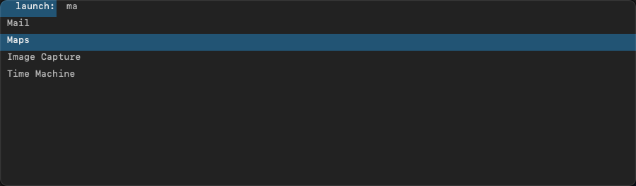

# zmenu

**A [dmenu](https://tools.suckless.org/dmenu/)-style menu for macOS, written in Zig.**

zmenu reads choices from standard input, lets you type to narrow them down, and prints the one
you pick. Use it from shell scripts, as an application launcher, or from a window manager such
as the zwm tiling window manager (which it was written alongside, but does not need).

<p align="center">
  <br>
  <sub>As a bar, drawn over the menu bar (it stops at the notch on notched displays)</sub>
</p>

<p align="center">
  <br>
  <sub>In a centered box (<code>-c</code>)</sub>
</p>

## Features

- **dmenu's matching and behavior:** every word you type must appear in an item; exact matches
  first, then items that start with the first word, then the rest.
- **Case-insensitive by default** (`-s` matches case-sensitively; `-i` is accepted for dmenu scripts).
- **A real text field,** so typing å, ø or æ, pasting, input methods and emacs keys all work.
- **A bar over the menu bar, or a centered box,** with a list (`-l`), on the monitor you are using.
  Notch-aware, with rounded corners where the screen has them.
- **A launcher:** with nothing piped in (or `-a`) it lists your applications and opens the one you pick.
- **Multi-select and a password mode.**

## Install

You need macOS on Apple silicon and [Zig](https://ziglang.org/) 0.17.0.

```sh
zig build -Doptimize=ReleaseSafe          # builds zig-out/bin/zmenu
cp zig-out/bin/zmenu ~/.local/bin/        # or anywhere on your PATH
```

`zig build test` runs the unit tests.

## Use

```sh
# in a script: choices on stdin, the pick on stdout
choice=$(printf 'red\ngreen\nblue\n' | zmenu -p 'colour:')

# standalone: with nothing piped in (or -a) it launches an application
zmenu                  # type "calc", press Return: opens Calculator
zmenu -a -c            # the same in a centered box

# more
git branch --format='%(refname:short)' | zmenu -c -l 10 | xargs git switch
```

It exits with 0 when you pick something, 1 when you cancel (Esc, or clicking elsewhere), and 2
for a bad option, so `if choice=$(... | zmenu); then ...` works.

Useful options: `-c` centered box, `-l N` list of N lines, `-b` bottom bar, `-p` prompt,
`-m N` monitor, `-fn "Menlo 14"` font, `-nb -nf -sb -sf` colours, `-H N` / `-H menubar` height,
`-R N` corner radius, `-P` password mode. `zmenu -h` lists everything.

**Picking several items:** press **Ctrl+Return** (or **Cmd+Return**) to pick the highlighted item and
keep the menu open; marked items are drawn in the `-ob`/`-of` colours, and **Return** finishes.

**Password mode (`-P`):** the field shows dots and what you type is printed, e.g.
`pw=$(zmenu -P -p 'password:' </dev/null)`. macOS also hides the keystrokes from other programs
while it is open.

## With zwm

zwm binds **Mod + P** to `zmenu -a` and **Mod + Shift + P** to `zmenu -a -c`, and sets the
environment variable `ZWM_MONITOR` to the number of the monitor you are working on (0 = leftmost),
which zmenu uses as the default for `-m`. Without it, zmenu opens where the mouse pointer is.
That is the whole connection: either program works without the other.

## Limits

- Apple silicon and Zig 0.17.0 only. Tested on macOS 27.2 with a notched display.
- Case folding is for ASCII letters only, and there is no `-f` option like dmenu's.
- On some Macs **Ctrl+Return is claimed before an app sees it**, so multi-select also answers to
  Cmd+Return.

## License and credits

zmenu is free software under the **GNU General Public License, version 3** (see `LICENSE`).
Its matching and behavior come from **[dmenu](https://tools.suckless.org/dmenu/)** by the suckless
community; the Objective-C calls go through **[zig-objc](https://github.com/mitchellh/zig-objc)**
by Mitchell Hashimoto. Their notices are in `THIRD_PARTY_NOTICES`.
